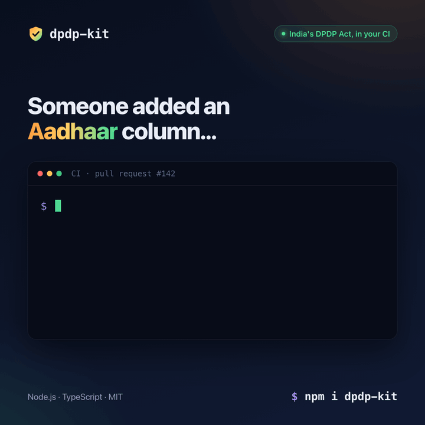

# dpdp-kit

[](https://github.com/yogesh2902/dpdp-kit/actions/workflows/ci.yml)

**The Node.js-native toolkit for India's Digital Personal Data Protection Act, 2023.** Build it into your Node.js backend.

**Website and docs: [yogesh2902.github.io/dpdp-kit](https://yogesh2902.github.io/dpdp-kit/)**



- **Declare why you hold each piece of personal data**, in one typed config file. A misspelt purpose is a type error.
- **Keep consent records that show tampering.** Each person's grants and withdrawals form a hash chain, with the notice version and language they saw.
- **Know what to erase.** When consent is withdrawn or an account is deleted, get a plan: which fields go, which stay (and why), which tables are under a legal hold, which third parties to tell.
- **Handle a breach on time.** Record it, find and tell the people affected, and track the Board's 72-hour deadline (Section 8(6), Rule 7).
- **Show who touched what.** An access log records who read whose data and why, flags reads outside a field's purpose, and keeps a year of entries, as Rule 6 requires. Encryption, tokens and masking for Aadhaar, PAN and other identifiers come in `dpdp-kit/protect`.
- **Check it in CI.** `dpdp-kit audit` fails the build when the data map is inconsistent, and the GitHub Action puts each problem on the pull request.
- **Catch drift.** `dpdp-kit audit --schema` reads your Drizzle, Prisma or Mongoose schema and fails the build when someone adds a `phone`, `email` or `aadhaar_number` column without saying what it's for, or when the data map points at columns that no longer exist. Compliance that can't quietly fall out of date.

## Node-native

dpdp-kit is a TypeScript library that runs **inside your Node.js process**, not a service you call.

- **No separate server.** There's nothing to deploy, no sidecar to keep running, and no REST API between your code and your consent records.
- **No hosted service.** No account, no API key, and no network calls. Personal data never leaves your infrastructure.
- **Your own database.** Consent records go into your own Postgres or MongoDB, through the Drizzle, Prisma or Mongoose setup you already have (or any Postgres client), in the same database as the rest of your data.
- **Fits your Node stack.** Typed config, guards for Express, Hono, Fastify and NestJS, a CLI for CI, and works with ESM, `require()` and TypeScript.

> **Not legal advice.** dpdp-kit helps you put compliance into practice; it does not make an app compliant on its own. Section and rule references point you to the text so you can check them. Have your own lawyer review your purposes, notices and retention periods.

## Install

```bash
npm install dpdp-kit
```

Node.js 20.19 or later. The package is ESM-only; `require("dpdp-kit")` also works on those Node versions.

## 1. Declare your data

```ts
// dpdp.config.ts
import { defineConfig } from "dpdp-kit";

export default defineConfig({
  fiduciary: { name: "Acme Pvt Ltd", grievanceUrl: "https://acme.in/privacy/grievance" },

  purposes: {
    account:       { basis: "legitimate-use", retain: "while-active" },
    order_updates: { basis: "consent", retain: "while-active" },
    marketing_sms: { basis: "consent", retain: { afterWithdrawal: "0d" } },
    analytics:     { basis: "consent", retain: { afterWithdrawal: "7d" } }, // time for the batch job to run
  },

  data: {
    users: {
      table: "users",
      subject: "id",
      fields: {
        phone:     { category: "contact", purposes: ["account", "order_updates", "marketing_sms"] },
        name:      { category: "identity", purposes: ["account"] },
        interests: { category: "behavioural", purposes: ["marketing_sms", "analytics"] },
      },
    },
    orders: {
      table: "orders",
      subject: "user_id",
      fields: { address: { category: "contact", purposes: ["account"] } },
      legalHold: { reason: "GST records", keep: "8y", then: "anonymise" },
    },
  },

  processors: {
    msg91:   { purposes: ["order_updates", "marketing_sms"] },
    posthog: { purposes: ["analytics"] },
  },

  minimumRetention: "1y", // Rule 8(3): keep data and logs of each processing at least one year
});
```

- **`basis`**: `"consent"` (Section 6) or `"legitimate-use"` (Section 7). For most apps a legitimate use means Section 7(a): data the person voluntarily gave you for a specified purpose, until they tell you they don't want it used. Keeping data because a law requires it is not a legitimate use; use `legalHold`.
- **`retain`**: `"while-active"`, a duration such as `"1y"`, or `{ afterWithdrawal: "7d" }` for consent purposes. Durations use `h`, `d` or `y`. Section 8(7)(a) says to erase upon withdrawal, so keep `afterWithdrawal` to the delay your systems really need.
- **`legalHold`**: another law makes you keep these rows (tax, KYC). Section 8(7) requires erasure "unless retention is necessary for compliance with any law". They are held, not erased.
- **`minimumRetention`**: Rule 8(3) requires keeping the personal data, traffic data and logs of each processing for at least one year from that processing, even after the account is deleted, but only for the purposes in the Seventh Schedule (requests from the State). The audit fails if this is under `"1y"`.

## 2. Check it

```bash
npx dpdp-kit audit            # exit code 1 on errors
npx dpdp-kit audit --strict   # also fail on warnings
```

```
✖ error    data.users.fields.phone.purposes
             Unknown purpose "acount". Declare it under `purposes` or fix the spelling.
⚠ warning  fiduciary.grievanceUrl
             Add where people can raise a grievance. Section 8(10) requires a grievance mechanism, and Section 5(1)(ii) requires the notice to say how to use it.
```

The same checks run when the app starts: `createDpdp` throws if the config has errors.

### Catch schema drift

A data map is only useful while it matches the database. Point the audit at your Drizzle schema (Postgres, MySQL or SQLite), your Prisma schema or your Mongoose models:

```bash
npx dpdp-kit audit --schema src/db/schema.ts
npx dpdp-kit audit --schema prisma/schema.prisma   # or a folder of .prisma files
npx dpdp-kit audit --schema src/models.ts          # a file that exports Mongoose models
```

```
✖ error    schema.users.aadhaar_number
             Looks like personal data (identity, matched "aadhaar") but isn't in the data map. Add it under `data`
             with the purposes it's held for, or add "users.aadhaar_number" to `notPersonal`.
✖ error    data.users.fields.interests
             Column "interests" isn't in table "users". Fix the name, or remove it if the column was dropped.
⚠ warning  schema.users.gender
             Looks like personal data (identity, matched "gender") but isn't in the data map. ...
```

It checks both directions:

- **New personal columns nobody mapped.** Columns are recognised by name: phone and email, Aadhaar, PAN, passport and voter ID, date of birth, names, addresses and PIN codes, UPI, IFSC and bank details, IP addresses and device IDs, health, biometric and location data. Clear cases are errors. Columns that are personal only sometimes, like `name`, `gender` or `city`, or anything named for a company or branch, are warnings.
- **A data map that points at nothing.** Tables or columns that were renamed or dropped.
- **Erase settings a column can't take.** Erasing a `NOT NULL` column to null, or writing text into a number column.
- **Foreign keys that break a legal hold.** Account deletion deletes the person's rows but keeps held ones, like invoices kept for GST. A foreign key from the held table to the users table defeats that:
  - `ON DELETE CASCADE` deletes the invoices with the account (an error).
  - `SET NULL` on the subject column loses whose invoices they are (an error).
  - `RESTRICT`, Prisma's default for a required relation, makes the deletion fail (a warning).

  Keep the link as a plain, indexed column instead.

Columns that describe data rather than hold it, such as `email_verified_at`, `phone_confirmed` and `address_type`, are not flagged. For anything that only looks personal, list it in the config:

```ts
notPersonal: ["products.name", "branches.*"], // database table and column names
```

From code, `checkSchema(config, drizzleSchema(schema))` returns the same issues. `drizzleSchema` comes from `dpdp-kit/drizzle`, `prismaSchema(text)` from `dpdp-kit/prisma`, and `mongooseSchema(models)` from `dpdp-kit/mongodb`. With Prisma, the data map can use model and field names (`User`, `phoneNumber`) or the database's (`users`, `phone_number`). Matching is by column name, so it can't see personal data hidden inside a JSON column or a vaguely named field. Review those by hand.

### In GitHub Actions

Add the audit to any workflow (it's on the [GitHub Marketplace](https://github.com/marketplace/actions/dpdp-kit-audit) as DPDP Kit Audit). Problems show up as annotations on the pull request, plus a summary on the run page:

```yaml
# .github/workflows/dpdp.yml
name: DPDP
on: [pull_request]
jobs:
  audit:
    runs-on: ubuntu-latest
    steps:
      - uses: actions/checkout@v4
      - uses: actions/setup-node@v4
        with:
          node-version: 22
      - run: npm ci                       # so your config can import dpdp-kit
      - uses: yogesh2902/dpdp-kit@main
        with:
          schema: src/db/schema.ts        # optional: also check for drift
          # config: dpdp.config.ts        # default: found automatically
          # strict: true                  # fail on warnings too
          # working-directory: apps/api   # for monorepos
```

`@main` follows the latest code; to pin a released version, use its tag, e.g. `yogesh2902/dpdp-kit@v0.3.0` (each release is on the [releases page](https://github.com/yogesh2902/dpdp-kit/releases)). The Action runs the dpdp-kit your project installed, falling back to `npx dpdp-kit@latest`. It sets `errors` and `warnings` outputs. Annotations need dpdp-kit 0.2.0 or later; with 0.1.x the check still runs and fails the build, without annotations. Outside GitHub, `npx dpdp-kit audit --format github` prints the same annotation lines.

## 3. Record consent

```ts
import { createDpdp } from "dpdp-kit";
import { drizzleData, drizzleStore } from "dpdp-kit/drizzle";
import * as schema from "./db/schema";
import config from "./dpdp.config";

export const dpdp = createDpdp({
  config,
  store: drizzleStore(db),                  // consent records, rights requests, erasure tasks
  data: drizzleData(db, { schema }),        // reads and erases personal data in your own tables
  processors: {                             // optional: tell third parties to stop or erase
    msg91: { stop: ({ subjectId }) => msg91.optOut(subjectId), erase: ({ subjectId }) => msg91.deleteContact(subjectId) },
  },
});

await dpdp.consent.grant(userId, ["marketing_sms", "analytics"], {
  noticeVersion: "2026-11",
  language: "hi",          // English or any of the 22 Eighth Schedule languages (Sections 5(3), 6(3))
  channel: "android",
  evidence: { ip: req.ip },
});

await dpdp.consent.has(userId, "marketing_sms");   // true
await dpdp.consent.active(userId);                 // ["marketing_sms", "analytics"]
await dpdp.consent.history(userId);                // every event, oldest first
await dpdp.consent.verify(userId);                 // { ok: true, events: 1 }
```

`has()` answers "do I hold consent, or not need it, for this purpose?". It is always `true` for legitimate-use purposes. Under Section 7(a) you must still stop once the person tells you they don't want their data used; v0.1 doesn't record that yet.

## 4. Withdrawals and deletions

```ts
const { erasure } = await dpdp.consent.withdraw(userId, ["analytics"]);
```

```jsonc
{
  "tables": [
    { "table": "users", "action": "erase-fields",
      "fields": [{ "field": "interests", "action": "erase", "after": "7d" }] }
  ],
  "processors": [{ "name": "posthog", "action": "erase", "ended": ["analytics"] }]
}
```

A field is erased only when **none** of its purposes remain. `phone` above stays because `account` and `order_updates` still need it, and the plan says so (`action: "keep", keptFor: [...]`).

```ts
await dpdp.erasure.plan(userId, { reason: "account-deletion" });
// users → delete-rows, orders → hold (GST records, 8y, then anonymise), processors → erase
```

**"Erase" is not "delete this second".** Every plan carries `minimumRetention` from your config. Under Rule 8(3), stop using the data now, keep a restricted copy only for the Seventh Schedule purposes, and delete it once a year has passed since its last processing. The Rule's own example is an e-book platform that keeps order details and logs for a year "even if X deletes her account".

### Carrying it out

`withdraw()` schedules the plan as dated tasks, and `erasure.deleteAccount(userId)` plans and schedules an account deletion. Then run the retention runner on a schedule; once a day is plenty:

```ts
const report = await dpdp.retention.run();   // { done, failed, manual }
```

| Task | When it runs | What it does |
|---|---|---|
| `processor-stop` | straight away | calls the processor's `stop` hook (Section 6(6)) |
| `erase-fields` | after `minimumRetention` (and `afterWithdrawal`) | sets the fields to `NULL` in the person's rows |
| `delete-rows` | after `minimumRetention` | deletes the person's rows (account deletion) |
| held table | after the legal hold (`keep`) | then anonymises (`NULL`s) or deletes, as `then` says |
| `processor-erase` | after `minimumRetention` | calls the processor's `erase` hook (Section 8(7)(b)) |

- **Safe to run from several servers.** Each task is claimed atomically, so it runs once.
- **Failures are retried**, up to 5 times. `lastError` keeps the database's message for developers, for example when a column is `NOT NULL`.
- **A processor with no hook** gives a `manual` task. Handle it yourself (email their support), then `retention.markDone(taskId, "ticket 4411")`.
- **Consent records are never erased.** Section 6(10) makes you prove consent, and Rule 8(3) requires keeping records of processing.
- **Erasure sets columns to `NULL` by default.** For a `NOT NULL` column, say what to write instead with the field's `erase` setting (below). Data access currently covers Postgres.

```ts
fields: {
  nickname: { category: "identity", purposes: ["newsletter"], erase: "redact" }, // "[erased]"
  points:   { category: "behavioural", purposes: ["newsletter"], erase: { value: 0 } },
  email:    { category: "contact", purposes: ["newsletter"], erase: { value: ({ subjectId }) => `erased-${subjectId}@invalid` } }, // NOT NULL UNIQUE
},
```

The replacement must not identify the person: use their internal id, never a hash of their data. `dpdp-kit audit --schema` checks each setting against your columns (a `NOT NULL` column erased to `NULL`, or text into a number column), so a mistake fails CI now instead of the erasure a year from now.

## 5. Rights requests

People can ask to see their data (Section 11), correct or erase it (Section 12), raise a grievance (Section 13) or name a nominee (Section 14). Each request is recorded with a due date:

```ts
const request = await dpdp.rights.open(userId, "grievance", { text: "I keep getting promo SMS" });
// request.dueAt is 90 days out: Rule 14(3) caps grievance responses at ninety days

await dpdp.rights.list({ overdue: true });               // your inbox of late answers
await dpdp.rights.resolve(request.id, "Promo SMS turned off");
await dpdp.rights.reject(otherId, "Duplicate of an earlier grievance");
```

**Access (Section 11):** `summary()` reads the person's personal fields from your tables, with the purposes each is held for, their consents, and the processors their data goes to:

```ts
const summary = await dpdp.rights.summary(userId);
// { data: [{ table: "users", fields: [...], rows: [{ phone: "98…", name: "Asha" }] }],
//   consents: ["order_updates"], legitimateUses: ["account"],
//   sharedWith: [{ name: "msg91", purposes: ["order_updates"] }] }
```

**Erasure (Section 12(3)):** every purpose ends except those you still need for the specified purpose. Legal holds and `minimumRetention` still apply:

```ts
await dpdp.rights.erase(userId, { keepFor: ["account"], requestId: request.id }); // schedules, resolves the request
```

Corrections and nominations are recorded with the request (`details`); your app applies them, then calls `resolve()`. Set your own answer times in the config. The Rules set ninety days for grievances only, and the audit fails above that:

```ts
rights: { responseWithin: { grievance: "30d", access: "30d" } },
```

## 6. Security safeguards and access logs

Rule 6(1) of the DPDP Rules sets the minimum security safeguards, and a breach of Section 8(5) carries the Act's highest penalty, up to ₹250 crore. The parts that live in code are built in.

**Access log (Rule 6(1)(c) and (e)).** Record who accessed whose data, why, and which fields:

```ts
await dpdp.access.log({
  actor: "support:priya",            // who
  subjectId: userId,                 // whose data
  purpose: "account",                // why: one of your purposes
  fields: ["users.phone", "orders"], // what: "table.field", or a whole table
  reason: "ticket 4411",
});

await dpdp.access.list({ subjectId: userId });  // investigate one person, an actor, or a period
await dpdp.access.review();                     // daily: find unauthorised access
await dpdp.access.prune();                      // keeps at least a year, as Rule 6(1)(e) requires
```

A field read for a purpose it isn't held for is recorded as `outOfPurpose` (or refused, with `createDpdp({ ..., access: { outOfPurpose: "throw" } })`). `review()` reports reads outside their purpose, consent purposes used when the person hadn't consented at that moment, and one actor reaching more than 100 people within an hour (both adjustable). Or log whole routes:

```ts
import { logAccess } from "dpdp-kit/express"; // or "dpdp-kit/hono"
app.get("/admin/users/:id", logAccess(dpdp, {
  purpose: "account",
  fields: ["users"],
  actor: (req) => req.staff?.id,
  subject: (req) => req.params.id,
}), handler);
```

**Encryption, masking and virtual tokens (Rule 6(1)(a)).** `dpdp-kit/protect` has AES-256-GCM field encryption with key rotation, keyed tokens for lookups, and masking:

```ts
import { createEncryptor, createTokenizer, maskAadhaar } from "dpdp-kit/protect";

const enc = createEncryptor({ keys: { k1: process.env.DPDP_KEY_1! }, current: "k1" });
const stored = enc.encrypt(aadhaar, `users.aadhaar:${user.id}`); // bound to this row
enc.decrypt(stored, `users.aadhaar:${user.id}`);

const tokens = createTokenizer({ key: process.env.DPDP_TOKEN_KEY! });
tokens.token(email); // same email → same token, so you can look rows up without storing the email in the clear

maskAadhaar("1234 5678 9012"); // "XXXX XXXX 9012"
```

Generate keys with `generateKey()` and keep them in your secrets manager. To rotate, add a new key, make it `current`, and re-encrypt values where `needsRotation(value)` is true.

**The rest, as evidence in the config.** Say how each field is protected, where each processor contract has its security clause (Rule 6(1)(f)), and the safeguards that live outside code:

```ts
data: { users: { /* … */ fields: { aadhaar: { category: "identity", purposes: ["kyc"], protect: "encrypted" } } } },
processors: { msg91: { purposes: ["marketing_sms"], contract: "DPA signed 2026-03-01, clause 7" } },
security: {
  accessControl: "SSO with least-privilege roles",           // Rule 6(1)(b)
  backups: "Encrypted daily backups, restore tested monthly", // Rule 6(1)(d)
  measures: "Annual security training, quarterly access reviews", // Rule 6(1)(g)
},
```

The audit warns about high-risk identifiers (Aadhaar, PAN, passport, bank account, card numbers, health and biometric data) without `protect`, processors without `contract`, and missing `security` entries. `npx dpdp-kit safeguards` prints the whole of Rule 6(1), (a) to (g), with what's recorded and what's missing (`--strict` fails on gaps).

## 7. Guard routes

```ts
// Express
import { requireConsent } from "dpdp-kit/express";
app.post("/promo", requireConsent(dpdp, "marketing_sms", { subject: (req) => req.user?.id }), handler);

// Hono
import { requireConsent } from "dpdp-kit/hono";
app.post("/promo", requireConsent(dpdp, "marketing_sms", { subject: (c) => c.get("userId") }), handler);
```

```ts
// Fastify
import { requireConsent } from "dpdp-kit/fastify";
app.post("/promo", { preHandler: requireConsent(dpdp, "marketing_sms", { subject: (req) => req.user?.id }) }, handler);

// NestJS
import { consentGuard } from "dpdp-kit/nestjs";
@UseGuards(consentGuard(dpdp, "marketing_sms", { subject: (req) => req.user?.id }))
@Post("promo")
sendPromo() {}
```

Without consent, the middleware responds `403 { error: "consent_required", purpose, message }`. The message is plain enough to show to people. Pass `onDenied` to send your own response; in NestJS, return the exception to throw, e.g. `(purpose) => new ForbiddenException(CONSENT_REQUIRED_BODY(purpose))`. Access logging works the same way in every framework: `logAccess` for Express, Hono and Fastify, `accessLogGuard` for NestJS.

## 8. Events

Listen for changes to feed your own audit trail, alerts or analytics:

```ts
const off = dpdp.on("consent.withdrawn", ({ event }) => analytics.forget(event.subjectId, event.purposes));
dpdp.on("access.logged", ({ entries }) => {
  if (entries.some((e) => e.outOfPurpose)) slack.alert("Out-of-purpose read", entries);
});
```

Events: `consent.granted`, `consent.withdrawn`, `erasure.scheduled`, `retention.ran`, `rights.opened`, `rights.closed`, `access.logged`. Listeners run after the change is saved and after the call returns, and a listener that throws can't break it: errors go to `onListenerError` (default `console.error`). For work that must happen exactly once, like telling a vendor to erase, use processor hooks and the retention runner instead.

## 9. Daily upkeep

One call does the jobs that must happen on time: carry out due erasure, prune access logs older than a year, review the last day of access, and list overdue rights requests.

```ts
const report = await dpdp.daily(); // { retention, accessPruned, review, overdueRequests, skipped }

// schedule it in-process, with no dependencies:
import { startDaily } from "dpdp-kit/schedule";
startDaily(dpdp, { at: "03:00", onReport: (r) => r.retention?.failed.length && alert(r) });
```

Or call `dpdp.daily()` from node-cron, a BullMQ repeatable job (to run it once across servers), or your platform's cron. It's safe to run from several servers at once.

## 10. Breach records

Section 8(6) and Rule 7: on becoming aware of a personal data breach, tell each affected person and the Board without delay, and send the Board a detailed report within 72 hours. Failing to notify carries up to ₹200 crore.

```ts
const breach = await dpdp.breach.open({ description: "A storage bucket exposed order exports.", fields: ["users.phone", "orders"] });
await dpdp.breach.addAffectedFromAccessLog(breach.id, { actor: "support:ravi" }); // or addAffected(id, userIds)

const notice = await dpdp.breach.notice(breach.id);  // Rule 7(1)(a)–(e), with fiduciary.dpo as the contact
await dpdp.breach.markNotified(breach.id, sentIds, { channel: "email" });

await dpdp.breach.boardNotified(breach.id);           // Rule 7(2)(a)
await dpdp.breach.updateReport(breach.id, { details, facts, mitigation, findings, remedial });
const report = await dpdp.breach.boardReport(breach.id); // (i)–(vi), (vi) built from the notice records
await dpdp.breach.reportSent(breach.id);

await dpdp.breach.status(breach.id); // { report: { dueAt, hoursLeft, overdue }, people: { total, sent, pending }, todo }
```

`dpdp.daily()` reports every open breach and its deadline, and a written Board extension can be recorded with `extend()`. dpdp-kit keeps the record and the clocks; you send the messages.

## Storage

### Drizzle (Postgres)

Add the tables to your schema so drizzle-kit creates them:

```ts
// schema.ts
export { accessLog, breachNotices, breaches, consentEvents, erasureTasks, rightsRequests } from "dpdp-kit/drizzle";
```

If you don't use drizzle-kit, run `DPDP_DDL` (exported from `dpdp-kit/drizzle`). This works with any Drizzle Postgres driver: node-postgres, postgres.js, Neon, PGlite.

> **Upgrading from 0.1.x?** Add `rightsRequests` and `erasureTasks` to your schema and generate a migration, or run `RECORDS_DDL`. `withdraw()` now schedules erasure tasks, so it needs the `dpdp_erasure_tasks` table.
>
> **Upgrading from 0.3.x?** Add `breaches` and `breachNotices` to your schema and generate a migration, or run `BREACH_DDL`. The audit now also warns when `fiduciary.dpo` is missing (Section 8(9), Rule 7(1)(e)).
>
> **Upgrading from 0.2.x?** Add `accessLog` to your schema and generate a migration, or run `ACCESS_LOG_DDL`, before using `dpdp.access`. The audit now warns about the Rule 6 safeguards; if you run it with `--strict`, add a `security` block and processor `contract`s first.

`drizzleData(db, { schema })` reaches your own tables. Pass your schema module when the data map uses Drizzle property names (`userId`) rather than column names (`user_id`).

### Prisma (Postgres)

Add dpdp-kit's models to `schema.prisma` and run `prisma migrate dev`:

```ts
import { PRISMA_MODELS } from "dpdp-kit/prisma";
console.log(PRISMA_MODELS); // paste into schema.prisma, or save as prisma/schema/dpdp.prisma
```

```ts
import { readFileSync } from "node:fs";
import { createDpdp } from "dpdp-kit";
import { prismaData, prismaSchema, prismaStore } from "dpdp-kit/prisma";

const schema = prismaSchema(readFileSync("prisma/schema.prisma", "utf8"));
const dpdp = createDpdp({ config, store: prismaStore(prisma), data: prismaData(prisma, { schema }) });
```

It runs parameterised SQL through `prisma.$queryRawUnsafe`, and works inside `prisma.$transaction(async (tx) => …)` with `prismaStore(tx)`. Tested on Prisma 7 with `@prisma/adapter-pg`. Every parameter has an explicit cast, so earlier versions should work too, but they aren't tested. The models match `DPDP_DDL`, so either can create the tables.

### Any other Postgres client

`dpdp-kit/postgres` needs only a function that runs a query with `$1` parameters: node-postgres, postgres.js, Kysely, Knex or Slonik.

```ts
import pg from "pg";
import { postgresData, postgresStore } from "dpdp-kit/postgres";

const pool = new pg.Pool();
const query = async (text: string, params: readonly unknown[]) => (await pool.query(text, [...params])).rows;
const dpdp = createDpdp({ config, store: postgresStore(query), data: postgresData(query) });
```

Create the tables by running `DPDP_DDL`, a plain SQL string exported by `dpdp-kit/postgres`.

### MongoDB and Mongoose

```ts
import { createDpdp } from "dpdp-kit";
import { mongoData, mongooseSchema, mongoStore } from "dpdp-kit/mongodb";

// the official driver
const dpdp = createDpdp({ config, store: mongoStore(client.db()), data: mongoData(client.db(), { ObjectId }) });

// Mongoose: a function, so dpdp can be created before mongoose.connect()
const db = () => mongoose.connection.db;
const dpdp = createDpdp({
  config,
  store: mongoStore(db),
  data: mongoData(db, { schema: mongooseSchema(mongoose), ObjectId: mongoose.Types.ObjectId }),
});
```

- Records go into `dpdp_*` collections. The store creates their indexes before its first write, including the unique `(subjectId, seq)` index that keeps each consent chain from forking. Call `createMongoIndexes(db)` from a deploy script if the app's user can't create indexes.
- In the data map, `table` is a collection, or a Mongoose model name with `schema`. Fields are document paths, so `"address.city"` works. With a Mongoose schema, `id` means `_id`.
- Pass `ObjectId` to find people by an ObjectId `_id`. Ids that look like numbers also match number fields.
- Erasure removes a field (`$unset`), or sets the field's `erase` replacement.
- `dpdp-kit audit --schema src/models.ts` reads the Mongoose models a file exports.

### Anything else

Implement `DpdpStore`: consent events (`lastEvent`, `insert`, `events`), requests and tasks (see `RequestStore` and `TaskStore`), and `AccessLogStore` for the access log. `insert` must throw `SeqConflictError` on a duplicate `(subjectId, seq)`, and `claimTask` must be atomic. A store with only the three consent methods still works for consent; rights and retention then throw `store-unsupported`. Implement `DataAccess` (`read`, `eraseFields`, `deleteRows`) for another database. `memoryStore()` and `memoryData()` are included for tests.

## How the consent record works

Section 6(10) puts the burden on you: if consent is questioned in a proceeding, the Data Fiduciary must prove that a notice was given and consent was given. That's why each event stores the notice version, language, channel and evidence, and why the record shows edits.

- Events are only ever added. Each has `seq` (1, 2, 3… per person), `prevHash` and `hash`, a sha256 over the event's fields and the previous hash.
- Two writes for the same person at once can't fork the chain. The second hits the `(subjectId, seq)` key and retries on top of the first.
- `verify()` recomputes every hash. It catches an edited event, a deleted event in the middle, and reordering.
- **Limitation:** deleting the *latest* events leaves a shorter chain that still verifies. To catch that, save `history().at(-1).hash` somewhere the database admin can't change, such as your logs or another system, and compare.

## Roadmap

| Version | Adds |
|---|---|
| **v0.1** | Config and types, `audit` + CLI, consent records, erasure plans, Drizzle store, Express/Hono guards |
| **v0.1.2** | Schema drift check: `audit --schema`, `checkSchema`, `drizzleSchema`, `notPersonal` |
| **v0.2.0** | Rights requests (Sections 11–14, Rule 14), retention runner that carries out erasure (Section 8(7), Rule 8(3), legal holds), processor hooks, `drizzleData`, GitHub Action with pull request annotations |
| **v0.3.0** | Security safeguards (Rule 6): access log with review and one-year retention, `dpdp-kit/protect` (encryption, virtual tokens, masking), `protect` / `contract` / `security` in the config, `dpdp-kit safeguards`; Fastify and NestJS guards; `logAccess` for every framework; events (`dpdp.on`); `erase` replacements for `NOT NULL` columns; `dpdp.daily()` and `startDaily` |
| next (0.4) | **Prisma and MongoDB** stores and data access (with a Prisma schema drift check); **breach records** with the deadlines of Section 8(6) and Rule 7 |
| then (0.5) | Notices that meet Rule 3 from the config, recording objections to a Section 7(a) use, an HTTP API with Express, Hono and Next.js adapters, completing rights requests, cross-border transfer records (Section 16) |
| after (0.6) | MySQL and SQLite data access, React and React Native consent screens, example apps |
| later | Children and guardian consent (Section 9, Rule 10), inactivity erasure (Rule 8(1)–(2), Third Schedule), erasure beyond SQL (files, caches, search indexes), Consent Manager interop (Sections 6(7)–6(9), Rule 4) |

## When the Rules apply

The DPDP Rules, 2025 were published on 13 November 2025 and start in phases (Rule 1):

- **Rule 4** (Consent Managers): one year after publication, November 2026.
- **Rules 3, 5 to 16, 22 and 23**, including notices, security safeguards, breaches, retention and erasure, children, and rights requests: **18 months after publication, May 2027.**

Building this in now gives you time to test before those obligations start.

## Legal sources

- **The Digital Personal Data Protection Act, 2023** (No. 22 of 2023), Gazette of India Extraordinary, Part II Section 1, 11 August 2023 (CG-DL-E-12082023-248045). Every Section reference here has been checked against this text.
- **The Digital Personal Data Protection Rules, 2025**, G.S.R. 846(E), 13 November 2025 (MeitY copy). Every Rule reference here has been checked against this text.
- **Corrigendum G.S.R. 892(E)**, 10 December 2025, published 11 December 2025 (CG-DL-E-12122025-268455). It makes 8 wording corrections, to Rule 1(3)–(4), Rule 11, Rule 19, the First Schedule and the Fourth Schedule. None changes anything cited here. Rule 1's "of this Gazette" becoming "in the Official Gazette" leaves the start dates unchanged.

Report a wrong or outdated reference as an issue. It's treated as a bug.

## Licence

MIT
